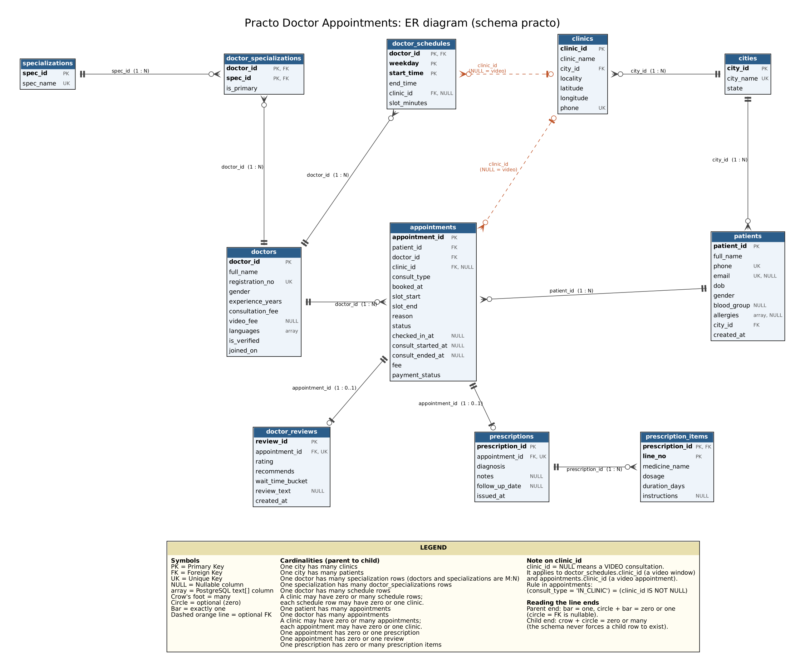
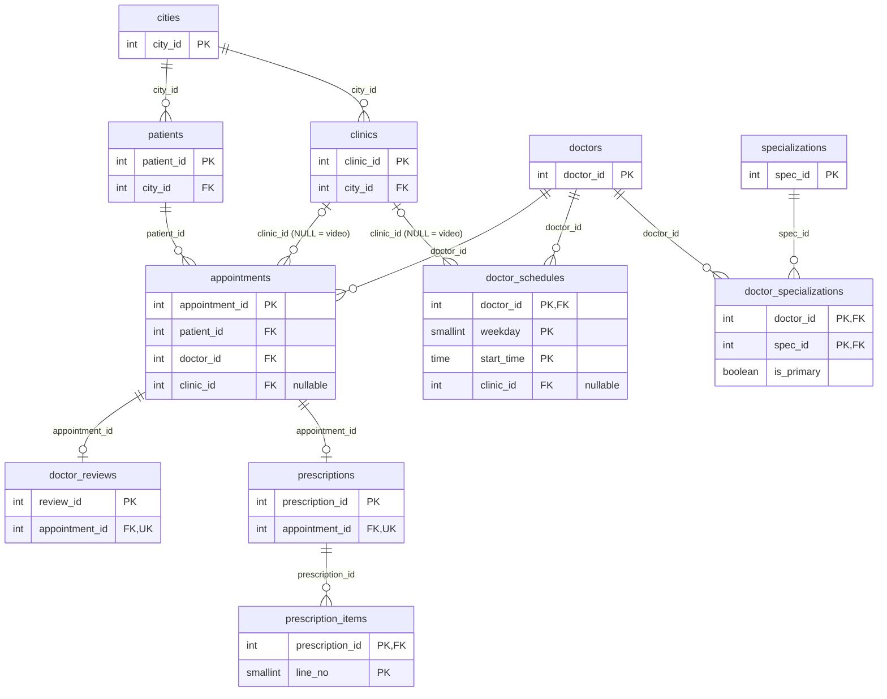

# Phase 2: Schema Design

**Project:** Practo Doctor Appointments Database (DBMS Project 15)
**Team:** EduWrap, Section A, Mentor: Satyaki
**Members:** Bala Vamsi Krishna (lead), Jayanth Pranay Konada, Shreya Das, Chekka Chandra Mouli
**Files:** `sql/01_schema.sql` (schema), `sql/02_load_data.sql` (load and checks), `diagrams/er_diagram.png`

## 1. How we worked the schema out

1. We loaded all 11 CSVs into a scratch schema with every column as `TEXT` and inspected the real data: distinct values of every code-like column, NULL counts, ranges, maximum lengths, value formats, uniqueness and orphan checks for every foreign key.
2. From those results we chose types, keys, NULL rules and CHECK constraints, and wrote `sql/01_schema.sql` (schema `practo`).
3. We read `queries/workload_30.sql` and made sure all 30 queries run on the schema unchanged. This caught one real problem: W02 and W04 use the status `CHECKED_IN`, which does not occur in the seed data, so the status CHECK allows it.
4. We loaded the CSVs into the real schema (`sql/02_load_data.sql`) and ran integrity checks (section 7).

All 11 files loaded without errors and all 11 row counts match the expected numbers (section 7.1). In the scratch inspection, all 12 foreign-key orphan checks returned 0.

## 2. ER diagram

Mermaid source:

**Note on `clinic_id`:** `clinic_id = NULL` means a **video consultation**. It applies to `doctor_schedules.clinic_id` (a video window) and `appointments.clinic_id` (a video appointment). In `appointments` this is enforced by `CHECK ((consult_type = 'IN_CLINIC') = (clinic_id IS NOT NULL))`, and the data matches it exactly (122,144 in-clinic rows all have a clinic, 27,856 video rows have none).

## 3. Relationships and cardinalities

| Parent | Child | Foreign key | Cardinality |
|---|---|---|---|
| cities | clinics | `clinics.city_id` | 1 : N |
| cities | patients | `patients.city_id` | 1 : N |
| doctors | doctor_specializations | `doctor_id` | 1 : N |
| specializations | doctor_specializations | `spec_id` | 1 : N |
| doctors and specializations | (through doctor_specializations) | | **M : N**. *At most one* primary specialization per doctor is enforced (partial unique index); *at least one* is not enforced, although the loaded data has exactly one for all 3,000 doctors |
| doctors | doctor_schedules | `doctor_id` | 1 : N |
| clinics | doctor_schedules | `clinic_id` (nullable) | 1 : N, optional (NULL = video) |
| doctors and clinics | (through doctor_schedules) | | **M : N** |
| patients | appointments | `patient_id` | 1 : N |
| doctors | appointments | `doctor_id` | 1 : N |
| clinics | appointments | `clinic_id` (nullable) | 1 : N, optional (NULL = video) |
| appointments | prescriptions | `appointment_id` (UNIQUE) | 1 : 0..1 |
| appointments | doctor_reviews | `appointment_id` (UNIQUE) | 1 : 0..1 |
| prescriptions | prescription_items | `prescription_id` | 1 : N (zero or many; the schema does not force an item) |

## 4. Data dictionary

All timestamps in the source datasets are provided with the +05:30 offset (Indian Standard Time). They are stored using PostgreSQL's `timestamptz` type, which keeps the exact instant and shows it in the session's time zone; checks that need calendar dates or clock times use `Asia/Kolkata` explicitly. Money is `numeric(8,2)` for exact decimals. Ids are plain `integer` primary keys because the CSVs supply them and W01 inserts an explicit `appointment_id`.

### cities
| Column | Type | Constraints | Why |
|---|---|---|---|
| city_id | integer | PK | Id from the CSV |
| city_name | text | NOT NULL, UNIQUE | 10 distinct names, no duplicates |
| state | text | NOT NULL | Always filled |

### specializations
| Column | Type | Constraints | Why |
|---|---|---|---|
| spec_id | integer | PK | Id from the CSV |
| spec_name | text | NOT NULL, UNIQUE | 15 distinct names |

### doctors
| Column | Type | Constraints | Why |
|---|---|---|---|
| doctor_id | integer | PK | Id from the CSV |
| full_name | text | NOT NULL | Always filled (max 19 characters) |
| registration_no | text | NOT NULL, UNIQUE, CHECK `~ '^[A-Z]{4}-[0-9]{6}$'` | All 3,000 follow `AAAA-999999`; no duplicates; R23 looks doctors up by it |
| gender | char(1) | NOT NULL, CHECK IN ('F','M') | Only F and M occur for doctors |
| experience_years | smallint | NOT NULL, CHECK 0 to 60 | Data is 1 to 38; small whole number |
| consultation_fee | numeric(8,2) | NOT NULL, CHECK > 0 | In-clinic fee (300 to 1,500) |
| video_fee | numeric(8,2) | NULL, CHECK > 0 and <= consultation_fee | NULL for the 894 doctors who do not offer video |
| languages | text[] | NOT NULL, CHECK cardinality >= 1 | A set of languages (CSV looks like `{English,Hindi}`); every doctor lists at least one |
| is_verified | boolean | NOT NULL | Values are `t` / `f` |
| joined_on | date | NOT NULL | Date only |

### doctor_specializations
| Column | Type | Constraints | Why |
|---|---|---|---|
| doctor_id | integer | PK (part), FK to doctors, ON DELETE CASCADE | Part of a doctor's profile |
| spec_id | integer | PK (part), FK to specializations, ON DELETE RESTRICT | Do not delete a specialization in use |
| is_primary | boolean | NOT NULL | Plus a partial unique index on `(doctor_id) WHERE is_primary` so a doctor has at most one primary |

### clinics
| Column | Type | Constraints | Why |
|---|---|---|---|
| clinic_id | integer | PK | Id from the CSV |
| clinic_name | text | NOT NULL | Always filled |
| city_id | integer | NOT NULL, FK to cities, RESTRICT | Every clinic is in a city |
| locality | text | NOT NULL | Always filled |
| latitude | numeric(9,6) | NOT NULL, CHECK -90 to 90 | Six decimals in the data |
| longitude | numeric(9,6) | NOT NULL, CHECK -180 to 180 | Same |
| phone | text | NOT NULL, UNIQUE, CHECK `~ '^\+[0-9]{2}-[0-9]{2}-[0-9]{7}$'` | All 1,500 follow `+99-99-9999999`; no duplicates; stored as text to keep `+` and `-` |

### doctor_schedules
Primary key `(doctor_id, weekday, start_time)`: there are no duplicate rows on these three columns, and the CSV has no id column.

| Column | Type | Constraints | Why |
|---|---|---|---|
| doctor_id | integer | PK (part), FK to doctors, CASCADE | Schedule belongs to the doctor |
| weekday | smallint | PK (part), CHECK 1 to 7 | ISO weekday, 1 = Monday. The data uses 1 to 6 (no Sunday); the range allows 7 for the business |
| start_time | time | PK (part) | Time of day, no date |
| end_time | time | NOT NULL, CHECK > start_time | 0 rows violate this |
| clinic_id | integer | NULL, FK to clinics, RESTRICT | NULL = video window (5,899 rows) |
| slot_minutes | smallint | NOT NULL, CHECK IN (10,15,20) | Only these three values occur |

Extra CHECK `ck_sched_window`: the window length is a whole number of slots (0 violations in the data).

### patients
| Column | Type | Constraints | Why |
|---|---|---|---|
| patient_id | integer | PK | Id from the CSV |
| full_name | text | NOT NULL | Always filled |
| phone | text | NOT NULL, UNIQUE, CHECK `~ '^[0-9]{10}$'` | Sign-in key (R06); all 40,000 have 10 digits and are unique |
| email | text | NULL, UNIQUE | 13,940 patients have no email; all non-empty emails are unique (PostgreSQL allows several NULLs under UNIQUE) |
| dob | date | NOT NULL, CHECK >= 1900-01-01 | Always filled |
| gender | char(1) | NOT NULL, CHECK IN ('F','M','X') | Three values occur |
| blood_group | text | NULL, CHECK IN the 8 groups | 3,204 patients have none recorded |
| allergies | text[] | NULL, CHECK NULL or at least one element | 33,986 patients have none recorded; no empty arrays in the data, so NULL is the only "none" |
| city_id | integer | NOT NULL, FK to cities, RESTRICT | Always filled |
| created_at | timestamptz | NOT NULL | Account creation time |

### appointments
| Column | Type | Constraints | Why |
|---|---|---|---|
| appointment_id | integer | PK | Id from the CSV; W01 supplies its own |
| patient_id | integer | NOT NULL, FK to patients, RESTRICT | Keep history |
| doctor_id | integer | NOT NULL, FK to doctors, RESTRICT | Keep history |
| clinic_id | integer | NULL, FK to clinics, RESTRICT | NULL = video; `CHECK ((consult_type='IN_CLINIC') = (clinic_id IS NOT NULL))` |
| consult_type | text | NOT NULL, CHECK IN ('IN_CLINIC','VIDEO') | Two values |
| booked_at | timestamptz | NOT NULL, CHECK <= slot_start | Booking happens before the slot (0 violations) |
| slot_start | timestamptz | NOT NULL | Start of slot |
| slot_end | timestamptz | NOT NULL, CHECK > slot_start and length IN (10,15,20) minutes | Matches the schedule slot lengths |
| reason | text | NOT NULL | Always filled |
| status | text | NOT NULL, CHECK IN ('BOOKED','CHECKED_IN','CANCELLED','COMPLETED','NO_SHOW') | `CHECKED_IN` does not occur in the data but W02 and W04 use it |
| checked_in_at | timestamptz | NULL | Only in-clinic visits are checked in (CHECK); always set for completed in-clinic visits and for `CHECKED_IN` |
| consult_started_at | timestamptz | NULL | Set if and only if status is COMPLETED, together with `consult_ended_at` (CHECKs) |
| consult_ended_at | timestamptz | NULL | Must not be before `consult_started_at` |
| fee | numeric(8,2) | NOT NULL, CHECK > 0 | Price at booking time (see section 6) |
| payment_status | text | NOT NULL, CHECK IN ('PAID','PENDING','REFUNDED') | REFUNDED only when status is CANCELLED (CHECK; all 8,879 refunds are cancellations) |

Status against the optional columns (from the data): BOOKED, CANCELLED and NO_SHOW rows have all three of `checked_in_at`, `consult_started_at`, `consult_ended_at` empty; COMPLETED in-clinic rows (98,820) have all three; COMPLETED video rows (22,589) have no check-in but both consult times.

### prescriptions
| Column | Type | Constraints | Why |
|---|---|---|---|
| prescription_id | integer | PK | Id from the CSV |
| appointment_id | integer | NOT NULL, UNIQUE, FK to appointments, RESTRICT | At most one prescription per appointment (0 duplicates); keep medical records |
| diagnosis | text | NOT NULL | Always filled |
| notes | text | NULL | 58,105 empty |
| follow_up_date | date | NULL, CHECK >= issue date (IST) | 68,184 empty = no follow-up |
| issued_at | timestamptz | NOT NULL | Always filled |

### prescription_items
Primary key `(prescription_id, line_no)`: a line number is only meaningful inside one prescription.

| Column | Type | Constraints | Why |
|---|---|---|---|
| prescription_id | integer | PK (part), FK to prescriptions, CASCADE | Items are part of the prescription |
| line_no | smallint | PK (part), CHECK > 0 | Data is 1 to 4 |
| medicine_name | text | NOT NULL | Free text, up to 23 characters |
| dosage | text | NOT NULL, CHECK `~ '^[0-9]-[0-9]-[0-9]$'` | All rows look like `1-0-1` |
| duration_days | smallint | NOT NULL, CHECK > 0 | Data is 3 to 30 |
| instructions | text | NULL | Mostly empty (97,233 of 243,085) |

### doctor_reviews
| Column | Type | Constraints | Why |
|---|---|---|---|
| review_id | integer | PK | Id from the CSV |
| appointment_id | integer | NOT NULL, UNIQUE, FK to appointments, RESTRICT | At most one review per appointment (0 duplicates) |
| rating | smallint | NOT NULL, CHECK 1 to 5 | Only 1 to 5 occur |
| recommends | boolean | NOT NULL | `t` / `f` |
| wait_time_bucket | text | NOT NULL, CHECK IN ('<15 min','15-30 min','30-60 min','>1 hr') | Four values |
| review_text | text | NULL | 12,069 empty |
| created_at | timestamptz | NOT NULL | Always filled |

## 5. Constraints and indexes

**CHECK constraints (40 in total):** doctors 7, clinics 3, doctor_schedules 4, patients 5, appointments 15, prescriptions 1, prescription_items 3, doctor_reviews 2.

**Foreign keys and what happens on delete**

| Foreign key | ON DELETE | Why |
|---|---|---|
| doctor_specializations.doctor_id, doctor_schedules.doctor_id | CASCADE | They only describe the doctor |
| prescription_items.prescription_id | CASCADE | Items are part of the prescription |
| doctor_specializations.spec_id, clinics.city_id, patients.city_id | RESTRICT | Do not delete reference data that is in use |
| appointments.patient_id, doctor_id | RESTRICT | Appointments are medical and financial history |
| prescriptions.appointment_id, doctor_reviews.appointment_id | RESTRICT | Keep medical records and reviews |
| doctor_schedules.clinic_id | RESTRICT | SET NULL would silently turn a clinic window into a video window |
| appointments.clinic_id | RESTRICT | SET NULL would turn an in-clinic appointment into one with no clinic and break the clinic CHECK |

**Indexes that exist (no tuning indexes):** the automatic indexes behind the 11 primary keys and the 8 UNIQUE constraints (`cities.city_name`, `specializations.spec_name`, `doctors.registration_no`, `clinics.phone`, `patients.phone`, `patients.email`, `prescriptions.appointment_id`, `doctor_reviews.appointment_id`), plus one partial unique index, `uq_doctor_one_primary_spec` on `doctor_specializations (doctor_id) WHERE is_primary`. It enforces *at most one* primary specialization per doctor, which a plain primary key cannot (the brief asks what stops a doctor having two primaries). It does not enforce *at least one*; the data has exactly one for all 3,000 doctors (check 3.4 in section 7.2). `sql/02_load_data.sql` prints the full index list from the database.

## 6. Functional dependencies and normal forms

For each table, "key" means every candidate key (primary key and UNIQUE columns).

| Table | Functional dependencies | Normal form |
|---|---|---|
| cities | city_id -> city_name, state; city_name -> city_id, state | BCNF (both determinants are candidate keys) |
| specializations | spec_id -> spec_name; spec_name -> spec_id | BCNF |
| doctors | doctor_id -> all other columns; registration_no -> all other columns | BCNF |
| doctor_specializations | (doctor_id, spec_id) -> is_primary | BCNF |
| clinics | clinic_id -> all other columns; phone -> all other columns | BCNF |
| doctor_schedules | (doctor_id, weekday, start_time) -> end_time, clinic_id, slot_minutes | BCNF |
| patients | patient_id -> all other columns; phone -> all; email -> all (when not NULL) | BCNF |
| appointments | appointment_id -> all other columns | 3NF by design (see below) |
| prescriptions | prescription_id -> all; appointment_id -> all | BCNF |
| prescription_items | (prescription_id, line_no) -> medicine_name, dosage, duration_days, instructions | BCNF |
| doctor_reviews | review_id -> all; appointment_id -> all | BCNF |

**Redundant or derived columns, and whether we keep them**

- **`appointments.fee`.** In all 150,000 rows it equals the doctor's fee for that consult type, so `(doctor_id, consult_type) -> fee` holds in today's data. We keep it because it is the price at the time of booking: doctors can change `consultation_fee` or `video_fee` later, and the appointment must keep what the patient was charged. The dependency is a coincidence of the current data, not a business rule.
- **`appointments.slot_end`.** It is `slot_start` plus the schedule's slot length. We keep it so an appointment keeps its own slot even if the schedule changes, and so queries (R03, R24) do not need to join to the schedule.
- **`appointments.consult_type`.** It could be derived from `clinic_id IS NULL`. We keep it as an explicit column, tied to `clinic_id` by a CHECK so the two can never disagree.
- **`doctor_reviews.wait_time_bucket`.** It is what the patient reported, not a value computed from timestamps, so it is not derived. We did not verify it against actual waiting times.
- **`doctor_reviews` has no `doctor_id`.** The doctor is reachable through `appointment_id`, so storing it again would be a redundancy; R14 joins instead.
- **`languages` and `allergies` are arrays.** Strictly, an array is not an atomic value, so first normal form would use child tables (`doctor_languages`, `patient_allergies`). We kept arrays because each is a plain set with no attributes of its own, always read together with its row, and the workload filters on them directly (`'Tamil' = ANY(languages)` in R18, `allergies @> ARRAY['Penicillin']` in R10). The trade-off is that an array column cannot have a foreign key to a list of allowed values.
- **`prescription_items.medicine_name`** is repeated free text (no medicines table exists in the data), so a medicine can be spelled in more than one way. We keep it because the queries (R10, R15) use the name directly.

## 7. Integrity checks

Run by `sql/02_load_data.sql` after the load; the results below are from that run.

### 7.1 Row counts
| Table | Expected | Loaded |
|---|---|---|
| cities | 10 | 10 |
| specializations | 15 | 15 |
| doctors | 3,000 | 3,000 |
| doctor_specializations | 3,700 | 3,700 |
| clinics | 1,500 | 1,500 |
| doctor_schedules | 30,499 | 30,499 |
| patients | 40,000 | 40,000 |
| appointments | 150,000 | 150,000 |
| prescriptions | 97,234 | 97,234 |
| prescription_items | 243,085 | 243,085 |
| doctor_reviews | 30,339 | 30,339 |

All 11 row counts match the expected counts.

### 7.2 Rules the data must obey (expect 0)
| Check | Result |
|---|---|
| 3.1 Appointments outside every schedule window of that doctor (weekday, IST clock time, same clinic, same slot length) | 0 |
| 3.2 In-clinic appointments at a clinic where the doctor has no schedule | 0 |
| 3.4 Doctors without a primary specialization | 0 |
| 3.5(a) Prescriptions on an appointment that is not COMPLETED | 0 |
| 3.5(b) Reviews on an appointment that is not COMPLETED | 0 |
| 3.6 Video appointments for a doctor with no video fee | 0 |
| 3.7 Appointments whose `fee` differs from the doctor's fee for that consult type | 0 |

**3.3 Allergy conflicts (a data-quality finding, not a failed check).** The Penicillin check found **726 records** (prescription items) where a patient with a recorded penicillin allergy was prescribed a penicillin-class medicine (matched by name: amoxicillin, ampicillin, penicillin). This is a patient-safety finding (problem P4, and R10 in the workload is the same idea). It is not a failed foreign-key or schema constraint, because no constraint can compare an allergy array with medicine names. The check also matches Aspirin and Sulfa by name (aspirin; sulfamethoxazole, co-trimoxazole), but only the Penicillin result is reported here.

### 7.3 Foreign keys
All 12 foreign keys were checked for orphans in the scratch inspection (0 orphans each). The real schema enforces them, so the successful load confirms this.

## 8. Data problems found

| # | Problem | Numbers | What we did |
|---|---|---|---|
| 1 | **Double bookings:** the same doctor has two non-cancelled appointments at the same `slot_start` | 559 pairs: 460 COMPLETED/COMPLETED, 50 NO_SHOW/COMPLETED, 41 COMPLETED/NO_SHOW, 5 NO_SHOW/NO_SHOW, 3 BOOKED/BOOKED | No unique constraint on `(doctor_id, slot_start)`, even a partial one, because the load would fail. This is exactly what the quality team's R24 report looks for |
| 2 | **Check-in after the consult started** on completed in-clinic visits | 16,183 rows | No CHECK `checked_in_at <= consult_started_at`. A data-quality issue; R09 is not affected because it measures `consult_started_at - slot_start` |
| 3 | **Payment oddities:** cancelled but still PAID; completed but still PENDING | 6,021 and 24,683 | Not constrained; relevant to finance reports. Refunds only on cancelled appointments is enforced |
| 4 | **`clinic_id` NULL for video windows** makes `NOT IN (SELECT clinic_id ...)` return nothing | 5,899 schedule rows with NULL | This is why R13 (clinics with no doctor schedule) returns an empty list (P5); it is a query logic bug, not bad data. Phase 4 uses `NOT EXISTS` |
| 5 | **No Sunday schedules:** weekday values are only 1 to 6 | | CHECK allows 1 to 7 |
| 6 | **`CHECKED_IN` is not in the data** but W02 and W04 use it | 0 rows | Status CHECK allows it |
| 7 | **Names and genders do not always match** (for example "Dr. Ananya Gupta" with gender M), so the data looks synthetic | | Left as is |
| 8 | **Appointments booked before the patient account was created** | 1,072 | Not constrained (a time rule across two tables cannot be a CHECK); reported as a data-quality issue |
| 9 | **Completed appointments without a prescription** | 24,175 | Not an error: a prescription is optional (121,409 completed appointments, 97,234 prescriptions, at most one per appointment) |

## 9. Assumptions

1. `weekday` follows ISO numbering (1 = Monday), confirmed because every appointment matches a schedule window under that numbering.
2. NULL in `blood_group`, `allergies`, `email`, `video_fee`, `follow_up_date`, `notes`, `instructions` and `review_text` means "not recorded / not applicable", never an empty string.
3. All timestamps in the source datasets carry the +05:30 offset (Indian Standard Time) and are stored as `timestamptz`. Calendar dates and clock times in our checks are computed in `Asia/Kolkata`.

## 10. Conclusion

The Practo Doctor Appointments database schema was designed after inspecting the supplied datasets and understanding the requirements of the provided SQL workload.

The final schema contains 11 relational tables with appropriate primary keys, foreign keys, unique constraints, CHECK constraints, and data types.

All 11 CSV datasets were loaded successfully, and the integrity checks confirmed that the key relational and business rules were satisfied. Existing data-quality anomalies were documented separately rather than introducing constraints that would reject the supplied data.

The resulting schema provides a consistent foundation for executing the prescribed workload and performing further database analysis.
